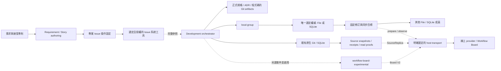
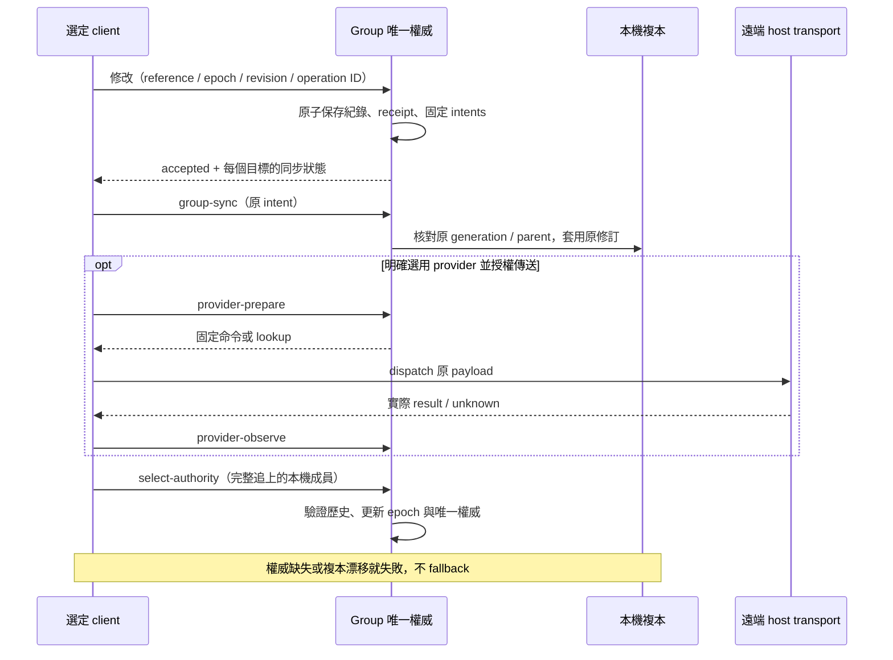

# Issue、workflow 與實驗性 Board

需求所在的 Issue 系統、協調開發的 orchestrator，以及保存執行紀錄的 store，
有不同責任。本頁描述目前來源能力；發布、安裝與真實 provider 驗收分別判定。

| 能力 | 擁有者 | 邊界 |
| --- | --- | --- |
| Feature／一般需求 | requirement-author | 撰寫需求，不授予 tracker 操作權限 |
| Story 與 AC | user-story-author | 指令型 authoring，不提供 tracker connector |
| Issue／Project 操作 | 專案選擇的 AI 原生工具、實驗性 issue-control 或 project route | 現有獨立 local-backlog 已退役；新的 issue-control provider skill 尚未提供 |
| 開發階段與交接 | software-development-orchestrator | 讀取明確 issue-operation 設定，協調已可用能力；不擁有 tracker 或 workflow store |
| workflow／task／文件／checkpoint | workflow-records | 原生 Git／SQLite，或 local-group 的檔案／SQLite；完整 reference 與 revision，不自動換來源 |
| group 多目標與唯一讀寫權威 | workflow-records local-group | 一個成員接受修改，保留固定同步 intents；明確追上後才能轉移 authority |
| 原生 snapshots、carrier 與 read proofs | workflow-records source-store | SQLite 保持 writer；schema 3 可另外選唯一讀取來源 |
| Board V2 bridges | workflow-board-experimental | 另行安裝與 `--activate`；host 執行實際 dispatch |

`external_work_refs` 只保存參照；新增內部 task 不會自動建立 Issue、修改 Project
或關閉外部項目。Issue-control 的三種選擇見[orchestrator 設定](skills/software-development-orchestrator.md)。
選擇尚未可用的 route 會停止該操作，不能默默換 provider。

普通 local-group 檔案是原子 JSON envelope，Git provider 是既有 workflow.yaml／task
格式。group SQLite 使用獨立 schema；原生 SQLite DB 不能直接附加為 group 成員。
新 group 預設檔案權威；本來源 repo 另外明確選定原生 SQLite 為唯一讀寫目標。
SourceReplica 的 `source_v1_*` 與 Board 協作 `v2_*` 不同，前者不經過 V2 bridge。
核心 prepare／validate 不啟用網路，也沒有背景同步。

## 接受、同步與來源切換

設定改動只影響未來目標；既有 intents、操作身份及 payload 保留，重試不產生新命令。
原生 source-store schema 3 的 read source 選擇不轉移 SQLite writer；不得套用上圖
的 group authority 語意。新 binding-disable 則明確停用原生 schema 2 binding，
保留歷史並標記 storage／backup 2.1，舊 runtime 拒絕；此控制不自動遷移 schema 3。

## 匯出、恢復與專案 schema

`export-files`／`group-export-files` 保存目前完整可讀紀錄、文件和附件原 bytes，
manifest 對應 YAML 與完整 sidecar。Project-owned schema／範本以路徑、版本和 hash
明確選用；只驗證，不補預設值或轉換。升級不覆寫 project 副本。舊自訂格式的
相容性需要真實樣本；檔案匯出不代表已實作其 import／restore。

完整 archive 另保留歷史及恢復資料，還原先 inactive。轉移寫入需要原 store
retirement 與唯一 successor claim；原 store 遺失後的可寫恢復仍是後續需求。
詳細格式及範例見[workflow-records](skills/workflow-records.md)。

## 選配、專案採用與驗收

`complete` 是具體的 17-skill preset，並非 catalog 全選；現有 presets 均不選入
workflow-records 或 Board 實驗性套件。選 Board bridges 必須同時選其 required
核心 dependency。Installer plan 顯示移除舊 Board members 與 local-backlog；
不從 binding 推定安裝，也不刪除 project records。

本來源 repo 的 SQLite-only 政策要求停用既有 Board binding、停止新 intent capture
及舊 pending dispatch；資料仍保留。本機儲存採用證據與產品跨 client 支援分開。
線上 Board 與多 Agents／跨廠商協作另行發展；單一 client 或模擬測試不能替代它們。
完成 workflow、合併 PR、關閉 Issue、Project 狀態及正式 tag／發布各自確認。
