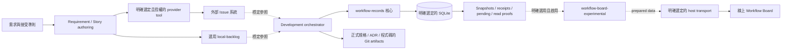
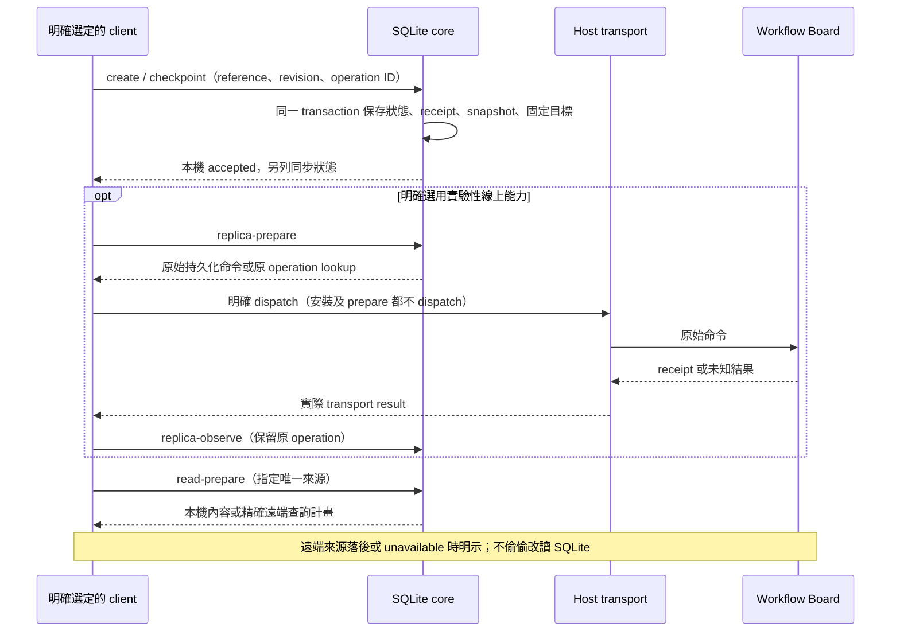
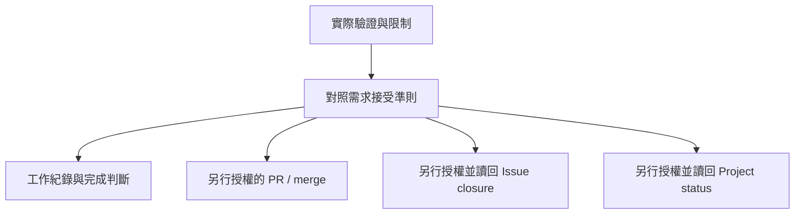

# Issue、workflow 與實驗性 Board

需求所在的 Issue 系統、協調開發工作的 orchestrator，以及保存工作紀錄的 store，
有不同責任。SQLite 核心可獨立離線使用；線上 Workflow Board 為另行安裝與啟用的
實驗性能力，實際線上驗收另行安排。本頁說明來源實作，不表示已發布或已安裝。

| 能力 | 目前擁有者 | 邊界 |
| --- | --- | --- |
| Feature／一般需求 | requirement-author | 撰寫需求；不授予 tracker 操作權限 |
| Story 與 AC | user-story-author | 指令型 authoring；無 tracker connector 或 store |
| 本機 work item | local-backlog | `<id>.work-item.json` 為權威；GitHub link 只作參照 |
| GitHub／Jira／ADO 工作項目 | 專案明確選定的 provider tools | 外部系統擁有其狀態；沒有單一名為 Issue 的 framework 執行模組 |
| 開發階段與交接 | software-development-orchestrator | 協調已具備的能力；不指定 store、schema 或 provider |
| workflow／task／文件／checkpoint | workflow-records | Git 或 SQLite；明確 reference 與 revision，無自動換來源 |
| source snapshots、carrier 配置與 read proofs | workflow-records source-store | SQLite authority；純本機資料及 prepare／observe，不作網路 dispatch |
| Board V2 bridges | workflow-board-experimental | 明確選用及 `--activate`；準備／驗證資料，host 另行 dispatch |

`external_work_refs` 是參照，不是 Issue 同步器。新增內部 task 不會自動建立 Issue、
改 Project 或關閉外部工作項目。現有 local-backlog 保留獨立入口；紀錄工具存在
不表示已具備等效 work-item lifecycle 或完成退役。

所有現有 presets 已不選取 workflow-records，本次也不加入實驗性套件。
Catalog 是可選套件全集，`complete` 是具體的 18-skill 選擇。選取實驗性套件時，
必須同時明確選取其 required dependency `workflow-records@0.2.0`；核心不反向依賴它。

## 本機接受與遠端複本

原生入口透過 [WorkflowRecords.provider](../src/skills/workflow-records/tools/workflow_records/service.py)
解析明確 reference。SQLite 原生更新在同一交易中保存 revision、receipt、事件、
[source snapshot 及已選定的 delivery intents](../src/skills/workflow-records/tools/workflow_records/source_store.py)。
Schema 3 的配置修訂與 carrier generations 保留先前接受操作的原 payload 與目標。
新增／移除 carrier 或切換 read source 不改 writer authority，也不重寫既有待補送。

本機操作不用 Board 執行檔、V2 schema 或網路。本機且沒有 replica 資料的備份
不用 jsonschema。核心保留的 SourceReplica 靜態 schema 用於已存在的 bindings、
命令、觀察與 proofs；選定這類嚴格驗證時仍需 jsonschema，不會因模組缺席而略過。
Schema 1／2 不自動升級；schema 3 需明確初始化，匯出／還原保留原 schema 與資料。

## 完成狀態各自判定

本機接受、遠端複本完成、實際 client 接續、程式碼整合及外部 Issue 關閉分別有
自己的證據。登入、ACL、分享、撤銷、真實線上跨 client 與恢復仍需另外驗收，
本機／模擬結果不替代它們。Codex 建立紀錄後由 Antigravity 接續的實測可提供該
SQLite 路徑的跨 client 證據，但不證明線上 Board 多 client、ACL 或未測 client。

## 升級與移除

舊合併套件的 Board 入口已搬到新 package；正常 installer plan 會呈現舊 managed
members 的移除及新選擇。仍需 Board bridges 的使用者應明確選取實驗性套件並審閱
計畫。系統不從舊 binding 偵測後自動新增套件，也不自動啟用、初始化或變更 DB。
只安裝核心時，source-store 收到 board-* operation 明確回 unavailable。

核心仍可保存、讀取、驗證、備份及還原既有 replica data；移除實驗性 bridges
不刪除原始 pending、receipts 或配置。所需純資料 validator 缺少時，依賴它的操作
明確 unavailable，不當作成功，也不切換權威。本來源庫已採用的 replica 配置與
真實儲存不因產品預設變更而自動修改。
